<p align="center">
  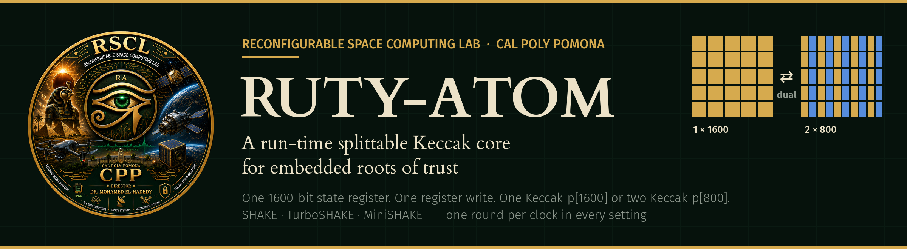
</p>

<p align="center">
  <b>Prof. Mohamed El-Hadedy</b><br>
  Professor of Electrical and Computer Engineering, Cal Poly Pomona · Director, Reconfigurable Space Computing Lab (RSCL)<br>
  Coordinated Science Laboratory, University of Illinois Urbana-Champaign<br>
  <a href="mailto:mealy@cpp.edu">mealy@cpp.edu</a> · <a href="mailto:hadedy@illinois.edu">hadedy@illinois.edu</a>
</p>

<p align="center">
  
  
  
  
</p>

---

<p align="center">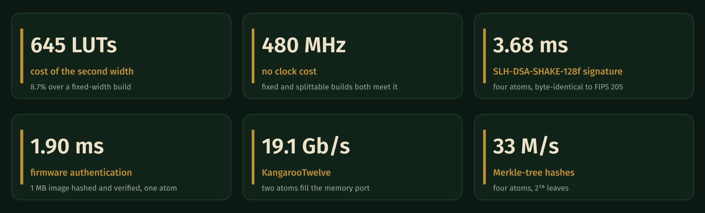</p>

## The idea

An embedded root of trust must now serve several Keccak hash families: SHAKE for the post-quantum standards, the 12-round TurboSHAKE
for speed, and the narrow MiniSHAKE for many short messages. A hash core holds one state at a time, so a narrow state leaves half of
its register idle. RUTY-ATOM puts that half to work, in the register the root of trust already owns.

<p align="center">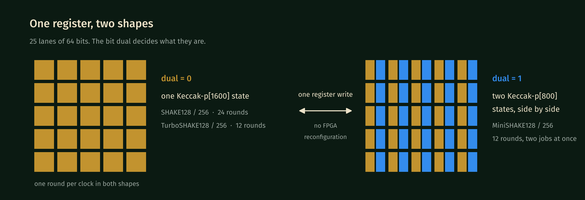</p>

It is called an **atom** because it is the smallest unit the scheduler owns: a system is *N* atoms, and software can split each one.

<p align="center">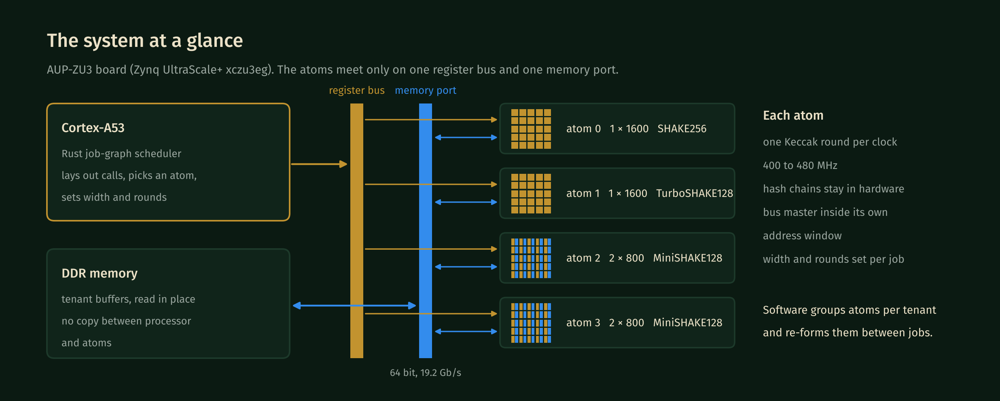</p>

## Where it stands

One real application per hash family, each run end to end on the board and set beside the work of others.

<p align="center">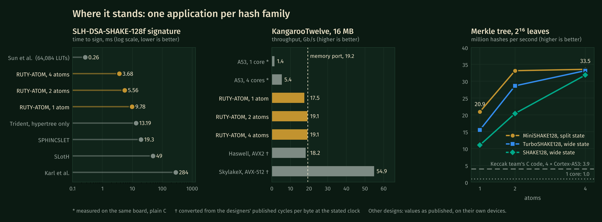</p>

| Family | Application | RUTY-ATOM | Against |
|---|---|---|---|
| **SHAKE** | SLH-DSA-SHAKE-128f keygen / sign / verify | 0.21 / 3.68 / 1.24 ms on four atoms, byte-identical to FIPS 205 | signs faster than SLotH, SPHINCSLET and Trident's hypertree part; Sun et al. are faster on every operation and Trident verifies faster |
| **SHAKE** | Firmware authentication, 1 MiB | 1.90 ms on one atom | no prior design reports megabyte messages |
| **TurboSHAKE** | KangarooTwelve (RFC 9861), 16 MiB | 19.1 Gb/s, all 18 RFC vectors reproduced | 3.5× the board's four Cortex-A53 cores |
| **MiniSHAKE** | Merkle tree, 2¹⁶ leaves | 33.5 million hashes per second | 8.6× the Keccak team's C code on four cores |

MiniSHAKE is a preprint construction, not a standard, and it has no published test vectors; here four implementations agree,
one of them built on the Keccak team's own permutation code. Signatures made with TurboSHAKE or MiniSHAKE are not FIPS 205 signatures.

**Scope.** RUTY-ATOM is the hash service of a root of trust, not the root itself. It assumes authenticated boot and a trusted bitstream,
its scheduler runs under Linux in this prototype, and the atoms have no side-channel protection. Sizes are binary: 1 MiB is 1,048,576 bytes,
also where a source comment or a log says MB.

## What it costs, and what the core gains

<p align="center">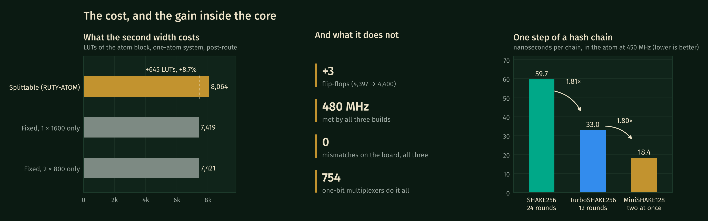</p>

Two fixed-width builds were made from the same code with the width tied to a constant, one wide and one narrow. They were placed, timed
and run on the board beside the splittable build: same digests, same chain-step times, and 645 fewer LUTs.

## The whole application, not the kernel

<p align="center">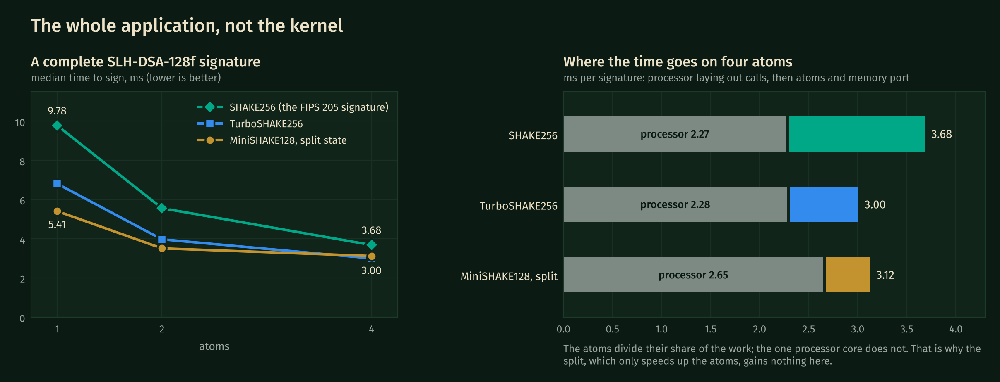</p>

## One law behind the gains

The split raises hash-chain throughput 1.80×: two chains advance together, at 18.4 ns per chain. Yet a full signature gains 1.26× on
one atom and nothing on four. Amdahl's law says why: a faster core pays in proportion to the share of time spent in it. With that share
measured, the law predicts the gains of a chain, a signature and a tree to within 8%, and explains the 2.4% that prior work found behind
an accelerator. Two more applications were forecast before they ran.

<p align="center">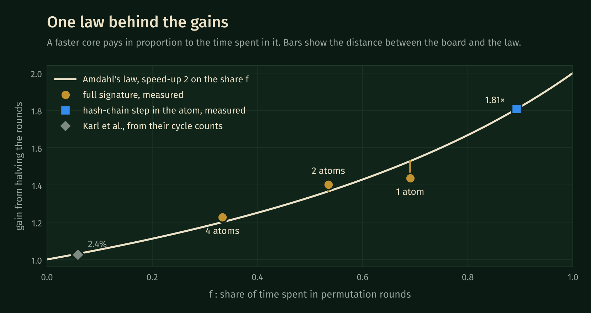</p>

## Forecast first, measure second

<p align="center">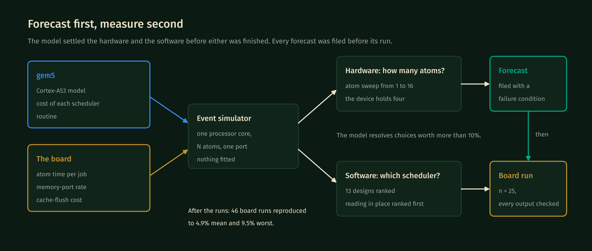</p>

<p align="center">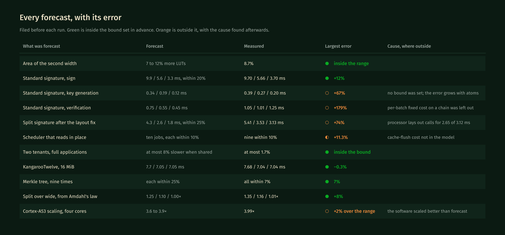</p>

The forecast files are in `results/` exactly as they were written. Git does not keep modification times, so `MANIFEST.sha256` records
the time of every file as it stood on the author's disk.

## Inside the atom

<p align="center">
  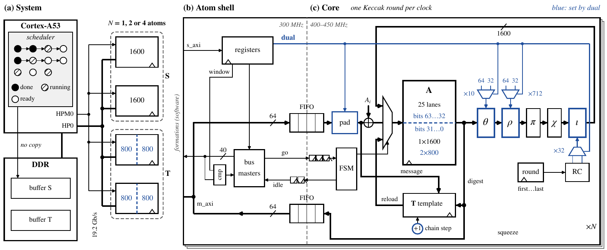<br>
  <sub><b>Schematic, as in the letter.</b> (a) system, (b) atom shell, (c) round core. Blue marks everything the <code>dual</code> bit sets:
  10, 712 and 32 one-bit multiplexers in the steps θ, ρ and ι.</sub>
</p>

<p align="center">
  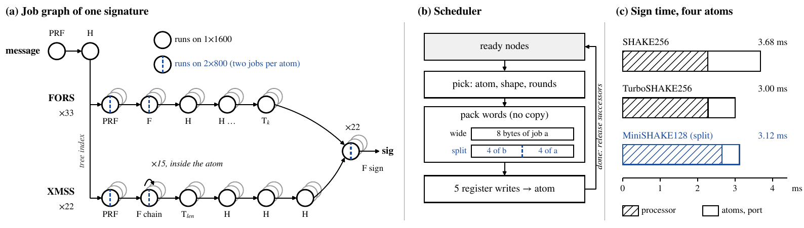<br>
  <sub><b>Software.</b> (a) one SLH-DSA signature as a job graph of 104,926 hash calls; (b) the Rust scheduler on one Cortex-A53 core;
  (c) median sign time on four atoms.</sub>
</p>

## Repository map

| Folder | What it holds |
|---|---|
| `rtl/` | The atom in Verilog (`rtl/atom`), the two fixed-width variants, and the earlier versions (`rtl/history`) |
| `bitstreams/` | FPGA images for one, two and four atoms (`ruty.bit` + `ruty.hwh`) |
| `software/` | Rust scheduler and applications, C baselines, run scripts and the Python checks; earlier versions in `software/history/` |
| `results/` | Unedited board logs and every forecast file |
| `model/` | The event simulator and the gem5 processor calibration |
| `reproduce/` | `check_claims.py`: recomputes the letter's numbers from the files above, one command |
| `synthesis/` | Vivado build scripts, the one-line summary of every build, and post-route timing and utilisation reports |
| `docs/` | The figures on this page and the scripts that draw them |
| `LICENSES/`, `MANIFEST.sha256` | The licence texts, and the hash, size and original time of every file |

<!-- TECHNICAL SECTIONS FOLLOW (platform, running it on the board, claim-to-file table, forecast protocol): merged from the staged
     release README once the last board runs are in. -->

## Run it on the board

**Platform.** AUP-ZU3 board: Zynq UltraScale+ xczu3eg-sfvc784-2-e, four Cortex-A53 cores at 1.2 GHz, PYNQ Linux. The atoms run on their
own clock (400 to 480 MHz); the bus and the memory port run at 300 MHz. The board needs `gcc`, `rustc`, PYNQ and 2 MiB huge pages.

**Layout on the board.** `~/Ruty/<image>/ruty.bit` and `ruty.hwh` for each image (`atom_v3_n1_450`, `atom_v3_n2_420`, `atom_v3_n4_400`,
and the two fixed-width images), and the files of `software/` in `~/Ruty/apps/`. Every script loads the image it needs, runs detached,
checks every output against a reference inside the program, and reloads the four-atom image when it ends.

| What | Command on the board | Logs in `results/` |
|---|---|---|
| Standard SLH-DSA-SHAKE-128f, firmware authentication, the TurboSHAKE and MiniSHAKE variants, two tenants | `nohup bash ~/Ruty/apps/run_sign4_all.sh > ~/Ruty/apps/run_sign4_all.log 2>&1 < /dev/null &` | `sign4_128f_*` |
| KangarooTwelve and the Merkle trees, with the Cortex-A53 software baseline | `nohup bash ~/Ruty/apps/run_modes.sh 25 12,16,20 > ~/Ruty/apps/run_modes.log 2>&1 < /dev/null &` | `modes_kt_*`, `modes_merkle_*`, `modes_sw_a53_*` |
| The Keccak team's permutation code as comparator (runs after the line above) | `bash ~/Ruty/apps/run_xkcp_modes.sh 25 12,16,20` | `modes_xkcp_*` |
| Fixed-width builds against the splittable build | `bash ~/Ruty/apps/start_fixcheck.sh` | `fixcheck_*` |
| The 3,411 NIST and RFC 9861 vectors on every atom of the three images, then Table I again with every individual run time logged | `nohup bash ~/Ruty/apps/run_audit.sh > ~/Ruty/apps/run_audit.log 2>&1 < /dev/null &` | `kat3_*`, `sign5_*`, `modes2_*`, `audit_run_log_aup1.txt` |

**Test vectors.** `ruty_kat3.py` reads the NIST SHA-3 XOF byte-oriented vector files (`shakebytetestvectors.zip` from the NIST CAVP page) and the text of RFC 9861.
They are not copied here; `results/audit_run_log_aup1.txt` lists the SHA-256 of each file that was used.

**Independent checks, on any PC with Python 3.** `check_sign_fips205.py` compares keys and signatures with an independent FIPS 205
implementation; `check_sign_variant2.py` and `check_modes2.py` recompute the non-standard variants, KangarooTwelve and the tree roots.
Their outputs are the `check_*` files in `results/`.

## Audit the letter in one command

```
git clone https://github.com/mealycpp/ruty-atom && cd ruty-atom
python3 reproduce/check_claims.py
```

`reproduce/check_claims.py` needs Python 3.8 or later and nothing else. It reads only what is in this repository: the board logs in `results/`,
the routed Vivado reports in `synthesis/reports/`, and the simulator in `model/`. No measured value is typed into the script; the only numbers
it carries are the ones printed in the letter, which are what it tests. For each claim it prints the letter's value, the value recomputed
from the raw file, the file, and the calculation, with one of three verdicts:

| Verdict | Meaning |
|---|---|
| `PASS` | the recomputed value, rounded to the digits the letter prints, equals the letter's value |
| `FAIL` | the evidence is there and gives a different value |
| `MISSING` | the evidence the claim needs is not in the repository |

The exit code is 0 only when every mandatory check passes. `reproduce/last_output.txt` is its output on the current commit.

**What it covers.** LUTs, flip-flops and clocks of every build from the implementation reports; the hash-chain step from the hardware clock
counter; every cell of Table I twice, from the median logged in the session the letter quotes and from the 25 individual times of a second session; the gains, limits and comparisons derived from them;
Amdahl's law with its measured share; the 116 width changes; the test vectors; the byte-identical FIPS 205 checks; the simulator re-run against
the 46 logged board times; the forecast errors; and the order of forecast and run from the times in `MANIFEST.sha256`.

**Tools and sources behind the files.**

| What | Version |
|---|---|
| Implementation | Vivado v2022.2 (64-bit, build 3671981), device xczu3eg-sfvc784-2-e |
| Board | AUP-ZU3, PYNQ Linux based on Ubuntu 22.04, kernel 6.6.10-xilinx-v2024.1; `rustc` 1.58.1, `gcc` 11.2.0, Python 3.10.4 |
| Processor model | gem5 v26.0.0.0, commit `9d368896ce119c17e1289dcbb18f33624724b843`, `build/ARM/gem5.opt`, syscall-emulation mode |
| Keccak team's permutation code | XKCP, commit `fa7033a212c831249b7e17e785ee1a4e24fc04c4` |
| Independent checks on a PC | Python 3.12.10; `slh-dsa` 0.2.5 (FIPS 205); `pycryptodome` 4.6.0 (KangarooTwelve) |

**Commands that produced the model files.** The gem5 run of the frozen processor model, whose output is `model/gem5_atom/calib/r4_pflat4.txt`
(all 40 settings tried and their outputs are in `model/gem5_atom/FROZEN_MODEL.md` and `calib/`):

```
build/ARM/gem5.opt -d m5out model/gem5_atom/ruty_se2.py --cmd model/gem5_atom/ruty_cost_aarch64 \
    --options "0 3" --cpu hpi --l1pf 2 --l1lat 1 --pflat 4
```

The same static binary (`software/ruty_cost.rs`) runs on the board; its outputs are `results/cost_native_a53*_aup1.txt`.
The simulator with those costs and nothing fitted, against the logged board times:

```
python3 model/sim/dfg_sim_gem5.py
```

The thirteen scheduler designs ranked on those same gem5 costs, nothing fitted (the Design method paragraph and Fig. 1 of the letter):

```
python3 model/sim/rank13_gem5.py            # writes the table kept in model/sim/design_ranking_gem5.txt
python3 model/sim/rank13_gem5.py fitted     # reproduces model/sim/design_ranking.txt from the fitted costs
```

On four atoms and the five mixed jobs the board ran, the nine designs that keep the processor's copy change the job time by -8.1% to +31.9%;
reading the buffer in place (no copy) saves 24.0% to 44.8% (board: 30.6% to 43.1%), and a second core doing the copy saves 28.7% to 53.5%.
This ranking was run on 2026-11-27, after the board measurements; the forecast filed before the no-copy run used the fitted costs (`results/forecast_dfg_no_copy_MODEL_2026-11-26.txt`).

## Every claim, and the file behind it

| Claim in the letter | Value | Where to look |
|---|---|---|
| The second width costs 645 LUTs and no clock | 8,064 against 7,419 LUTs; all builds meet 480 MHz | `synthesis/results_sys.txt`, `synthesis/reports/<build>/route_util_hier.rpt`, `route_timing.rpt` |
| The 3,411 NIST and RFC 9861 test vectors | 0 mismatches on each of the 7 atoms of the three images | `results/kat3_*_aup1.txt` |
| Fixed-width builds behave the same on the board | 0 mismatches; 59.7, 33.0 and 18.4 ns per chain step | `results/fixcheck_*_aup1.txt` (two runs) |
| Standard signature, byte-identical to FIPS 205 | keygen 0.41 / 0.27 / 0.21, sign 9.78 / 5.56 / 3.68, verify 1.02 / 1.00 / 1.24 ms | `results/sign4_128f_std_*`, `check_sign4_128f_std_*_fips205.txt` |
| Firmware authentication, 1 MiB | 1.90 / 1.90 / 2.18 ms | `results/sign4_128f_fw_*`, `check_sign4_128f_fw_*_fips205.txt` |
| TurboSHAKE256 and MiniSHAKE128 signatures (not FIPS 205) | 6.81 / 3.97 / 3.00 and 5.41 / 3.51 / 3.12 ms | `results/sign4_128f_turbo_NONSTANDARD_*`, `sign4_128f_mini_NONSTANDARD_*`, `check_sign4_*_python.txt` |
| Two tenants with full applications | at most 1.7% slower | `results/sign4_128f_tenants_4atoms_aup1.txt` |
| Width changed between jobs on running atoms | 116 changes (57 to the split state, 59 back), 0 wrong digests | `results/atom_tenants_n4_400_aup1.txt` |
| KangarooTwelve, 16 MiB | 7.68 / 7.04 / 7.04 ms, 18 RFC 9861 vectors | `results/modes_kt_*`, `modes_check_python.txt` |
| Merkle tree, 2¹⁶ leaves | 6.28 / 3.96 / 3.92 ms split; 8.47 / 4.58 / 3.96 ms wide | `results/modes_merkle_*` |
| The Keccak team's C code on the Cortex-A53 | 133.7 ms on one core, 33.5 ms on four | `results/modes_xkcp_sw_a53_aup1.txt`, `modes_xkcp_digests_aup1.txt`, `modes_xkcp_roots_aup1.txt` |
| Forecasts | filed before each run | `results/forecast_*.txt` |
| Simulator against the board | 46 runs, 4.9% mean and 9.5% worst | `model/sim/`, `model/gem5_atom/` |

Times are medians of 25 runs at one, two and four atoms. Other designs in the figures are quoted as their papers report them, on their own
devices; the reference list of the letter gives the sources.

## Licence

The work is reciprocal: anyone may use, study and build on it, and anyone who distributes a modified version must publish it under the same terms.

| Part | Folders | Licence |
|---|---|---|
| Hardware: RTL, build scripts, bitstreams | `rtl/`, `synthesis/`, `bitstreams/` | CERN Open Hardware Licence v2, Strongly Reciprocal (`CERN-OHL-S-2.0`) |
| Software: board programs, checks, simulator, figure scripts | `software/`, `model/`, `docs/figure_scripts/` | GNU General Public License v3 or later (`GPL-3.0-or-later`) |
| Results, figures and this page | `results/`, `docs/img/`, `README.md` | Creative Commons Attribution 4.0 (`CC-BY-4.0`) |

The full texts are in `LICENSES/`, and every source file carries its identifier in the first lines. Copyright (c) 2026 Mohamed El-Hadedy.

## Citation

```bibtex
@article{elhadedy_rutyatom,
  author  = {Mohamed El-Hadedy},
  title   = {{RUTY-ATOM}: A Run-Time Splittable {Keccak} Core for Embedded Roots of Trust},
  journal = {IEEE Embedded Systems Letters},
  note    = {Submitted}
}
```

## Acknowledgment

<p align="center">
  
</p>

This research was funded by AFRL under Agreement FA8650-24-2-2403, the U.S. Department of Defense under Award W911NF-24-1-0265, and
the U.S. Navy NEEC under Grant N00174-23-1-0002. The views and conclusions are those of the author and do not necessarily represent
the official policies of the sponsors or the U.S. Government.

<p align="center"><sub>Reconfigurable Space Computing Lab · California State Polytechnic University, Pomona</sub></p>
